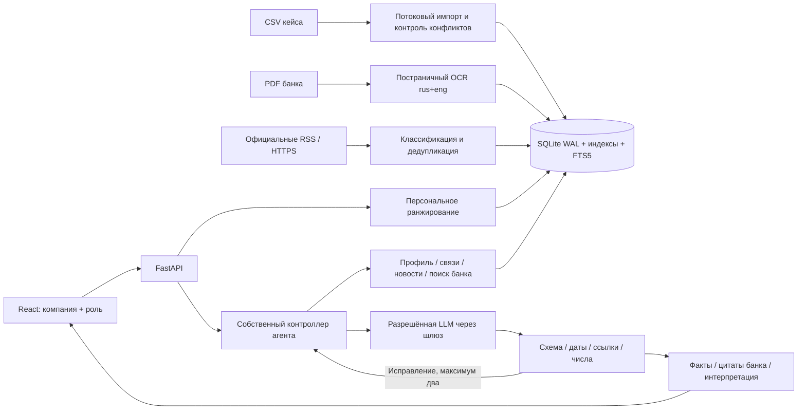

# Бизнес Пульс · Альфа Хак

**Посмотреть интерфейс без установки:** https://9534302200k-pixel.github.io/-/

Это отдельная интерактивная визуальная демонстрация: четыре учебные компании, переключение ролей, карточки, источники и журнал. Данные синтетические, примеры ответов подготовлены заранее, запросов к модели и серверу нет. Основной серверный продукт описан ниже. Для открытия сохранённого файла без сервера доступен `preview/business-pulse.html`.

Работающий конкурсный сервис персональной новостной аналитики: компания и роль → ранжированная лента → факты, выдержки из аналитики Альфа-Банка и отдельная интерпретация → уточняющий вопрос → проверяемые основания и журнал действий.

**Текущая граница готовности:** интерфейс, импорт полного набора, OCR, поиск, правила персонализации, контроллер агента, проверки и Docker реализованы. Живая генерация разрешённой LLM не проверена: в материалах нет адреса шлюза, ключа, точного API ID и тарифов. Без них приложение честно работает в режиме разбора по правилам. Такой режим сам по себе **не закрывает AI-требования конкурса**. Реальная интеграция с интернет-банком отсутствует; точка входа показана в конкурсном макете.

## Быстрый запуск

Нужны Docker Engine и Docker Compose v2.24+; для сборки — интернет. Практический стартовый ориентир: Linux amd64, 2 vCPU, 2 ГБ RAM, 5 ГБ свободного диска. При OCR крупных документов может потребоваться больше; тариф VPS за 2–3 евро без проверки ресурсов не выбран.

```bash
cp .env.example .env
docker compose up --build -d
docker compose exec pulse python -m scripts.smoke
```

Интерфейс — порт 8000 на локальном компьютере. `/api/health` проверяет процесс и БД, `/docs` содержит OpenAPI. Порт Compose привязан к loopback; доступ снаружи настраивается отдельно через HTTPS reverse proxy. Общий код доступа задаётся в `APP_ACCESS_TOKEN`; исходные синтетические компании не требуют отдельной учётной записи.

По умолчанию запускаются четыре явно синтетических профиля и шесть учебных событий. Это воспроизводимый сценарий проверки без внешних зависимостей. Учебные тексты **не выдаются за новости или позицию банка**. После импорта реальных профилей подготовленные учебные события из их ленты исключаются; вручную добавленные тестовые новости сохраняют тестовую метку.

## Исходные данные кейса

Ссылки взяты из PDF кейса, стр. 15 и 17:

- CSV: https://drive.google.com/drive/folders/1Ep8wWoEHTg5Q8kwrLx2j_xFyxGUEVxFq
- Аналитика: https://drive.google.com/drive/folders/15xZTLF1lZ65p6o5xpNA_fRbxjoV-UlG1

```bash
docker compose exec pulse python -m scripts.import_case --download /app/data/case --import-data
```

Команда получает обе папки через проверенный HTTPS, создаёт локальный SHA-256-манифест и импортирует CSV потоково. PDF извлекаются постранично; сканы проходят Tesseract `rus+eng`. Для известных файлов даты подтверждены OCR-текстом и привязаны к SHA-256 в [каталоге](docs/case-materials.json). Обзор золота содержит только месяц на обложке и данные начала сентября: точная дата не придумана, документ остаётся в библиотеке, но исключается из текущего поиска. Дату можно уточнить в интерфейсе после проверки первоисточника.

Папка `data/` и `.env` не входят в Git. Данные живут в томе `pulse-data`; обычный перезапуск их сохраняет. Не удаляйте том при обновлении. Повторный импорт того же содержимого не создаёт дубликаты, включая переименованный CSV. Изменённый файл платежей рассматривается как отдельный набор наблюдений: перед заменой набора нужен согласованный импорт, иначе возможны пересечения.

Импорт через интерфейс: «Источники и данные → Импорт данных». Доступны профили, платежи, связи физлиц и PDF. Имена полей соответствуют приложению 1. Платежи — `df_Uid_payment_hack.csv`, хотя в PDF имя файла продублировано ошибочно.

Подтверждённые результаты текущего импорта: 85 525 исходных строк профилей / 85 514 компаний, 1 380 585 платёжных строк, 12 514 связей физлиц, 9 PDF / 64 страницы. Это результаты исходного набора, не нагрузочная гарантия для любого VPS.

## Подключение конкурсной модели

Заполните на сервере `.env`, затем `docker compose up -d --force-recreate`. Никогда не помещайте ключ в Git, браузер или сообщения.

| Переменная | Назначение |
|---|---|
| `LLM_BASE_URL` | HTTPS endpoint OpenAI-compatible API, включая `/v1`, если это требует шлюз |
| `LLM_API_KEY` | Общий ключ команды от организаторов |
| `LLM_MODEL_ID` | Точный идентификатор модели в шлюзе |
| `LLM_MODEL_FAMILY` | Точное название одной из шести семей из приложения 3 |
| `LLM_INPUT_RUB_PER_MILLION` | Подтверждённый тариф входных токенов |
| `LLM_OUTPUT_RUB_PER_MILLION` | Подтверждённый тариф выходных токенов |
| `DAILY_BUDGET_RUB` | Локальный лимит, не больше 500 ₽ |
| `LLM_CONTEXT_LIMIT` | Консервативный предел размера JSON-контекста **в байтах UTF-8**, не в токенах |
| `LLM_MAX_OUTPUT` | Лимит выходных токенов одного вызова |
| `REVENUE_MULTIPLIER` | Множитель единиц выручки после подтверждения организаторов |
| `REVENUE_UNIT_CONFIRMED` | Разрешает утверждать соответствие реального клиента порогу 15 млрд ₽ |

Разрешены только: Gemma 4 26B A4B, GLM-5.3-Flash, Qwen3.6 35B A3B, DeepSeek-V4.1-Flash, Qwen3-VL-30B-A3B-Instruct, Kimi-K2.6. Продукт не использует другие LLM, внешние embedding-сервисы или готовые агентные системы. Соответствие API ID выбранной семье и совместимость JSON mode нужно подтвердить по документации шлюза; само имя в настройках не доказывает, какая модель реально стоит за endpoint.

Запрос к организаторам подготовлен в [ORGANIZER_REQUEST.md](docs/ORGANIZER_REQUEST.md). После подключения обязательны живой сквозной тест на новой новости, проверка расходов и экспертная оценка качества. Тесты с подменённым шлюзом проверяют контроллер, но не доказывают качество LLM.

## Источники новостей

Автообновление RSS Банка России каждые `NEWS_POLL_MINUTES` минут; первоначальное получение запускается кнопкой «Обновить». Реализованы две официальные ленты: новости и пресс-релизы. Ручной импорт по URL разрешён только с HTTPS-доменов Банка России, Росстата, Минфина, Минэкономразвития и Альфа-Банка, перечисленных в `backend/sources.py`. Все перенаправления проверяются, произвольные адреса модель не открывает.

Добавление новой новости: «Добавить новость → официальная ссылка». Если дата не найдена на странице, её нужно указать. Для демонстрации ранее неизвестного события можно вставить тестовый текст: он всегда получает тестовую метку. Ошибки доступа отображаются в «Источниках», а не скрываются старой выдачей. Прямое получение полного текста по ссылке не гарантируется для любого макета официального сайта; RSS хранит опубликованное источником описание.

## Архитектура



Один сервер Python обслуживает API и собранный React. Одна SQLite БД с WAL и индексами достаточна для конкурсного набора и одного небольшого стенда. Один процесс Uvicorn обязателен для локальных ограничителей запросов и параллелизма. Логика не привязана к выбранным демонстрационным компаниям. Для нескольких реплик потребуется PostgreSQL, общая очередь задач, распределённый бюджет и IAM; это дальнейшее развитие, не скрытая зависимость текущего запуска.

Агент выполняет собственный многошаговый процесс: фиксирует цель и роль, получает профиль и платёжный контекст; модель выбирает ограниченные инструменты; сервер выполняет поиск и чтение; при отсутствии свежего материала меняет запрос; модель формирует структурированный ответ; контроллер проверяет схему, существование ссылок и числовые утверждения, допускает два исправления. Вопрос продолжает контекст предыдущего ответа с проверкой компании, события и роли. Журнал содержит существенные действия и основания, не скрытые рассуждения модели.

Перед платным вызовом резервируется верхняя оценка стоимости; после ответа учитываются токены шлюза. При неизвестном исходе резерв сохраняется. Сутки считаются по Москве. Бюджет общий для этого экземпляра, а не для любых других приложений, использующих тот же командный ключ. Кэш учитывает профиль, роль, событие, корпус, версию контроллера, модель и дату; проверяется до платного планирования.

## Ограничения данных и безопасность

- Конфликтующие поля не выбираются произвольно. Один профиль исходного набора имеет конфликтующие записи; исходные варианты сохранены.
- Не установлены единицы выручки, период и валюта платежей. Повторные пары платежей сохранены; финансовые итоги по ним не выдаются за оборот за известный период.
- Наличие кредита не доказывает сумму, тип ставки или изменение фактических расходов. Калькулятор работает только на введённых пользователем параметрах и показывает допущения.
- Платёжная связь не доказывает поставки; связь физлица — должность или владение. Доля рынка без объёма рынка неизвестна; групповая выручка не складывается автоматически.
- Датированные материалы из будущего не используются. Обзоры старше 120 дней помечаются как исторические. OCR может ошибаться в цифрах: есть связь с исходной страницей, но нужен экспертный контроль.
- Модель не получает произвольных инструментов, исполняемого кода, права платежа или отправки сообщений. Инструкции внутри источников считаются данными. URL ограничены фиксированными официальными хостами; внутренние IP отклоняются, а в облаке с proxy DNS разрешается средствами прокси.
- Общий код доступа защищает **весь конкурсный стенд**, не является индивидуальной банковской авторизацией. Все допущенные демонстраторы могут переключать компании и роли. Для реального внедрения до поиска необходимы индивидуальные права из банковского IAM, аудит доступа и согласованный процесс работы с данными.
- Ответы проверяются механически; наличие цитаты не доказывает логическую истинность. Результаты требуют экспертной проверки.

## Проверка

Локальная разработка: Python 3.12, Node 22+ и Tesseract 5 с `rus+eng`.

```bash
bash scripts/setup_cloud.sh
bash scripts/start.sh
```

В отдельном терминале:

```bash
.venv/bin/python -m pytest -q
.venv/bin/python -m scripts.smoke
npm --prefix frontend run build
```

Браузерные проверки используют системный Chromium или `BROWSER_EXECUTABLE`. Если его нет, установите Chromium / `playwright install chromium`. Запуск без браузерных тестов: `pytest -q -m 'not browser'`; пропущенные проверки не считаются пройденными.

Ручной сценарий: главная → «Перейти к аналитике» → выбрать компанию и роль → открыть карточку → проверить факт и страницу банка → открыть действия агента → задать вопрос → сменить роль → сохранить событие → добавить ранее не использованную новость → проверить журнал и обратную связь. В настройках видно, используется ли настоящая модель.

В «Работе аналитика» показаны фактические задержки, число запусков по режимам, оценки пользователей и расход. Precision@5, глубина интерпретации и бизнес-эффект не объявлены достигнутыми: нужен отложенный экспертно размеченный набор. План — [QUALITY.md](docs/QUALITY.md). Покрытие условий кейса — [CASE_COVERAGE.md](docs/CASE_COVERAGE.md).

## Размещение и версия

Инструкция для VPS/Aeza — [DEPLOYMENT.md](docs/DEPLOYMENT.md). Публичное размещение, домен и банковские интеграции в этой работе не выполнялись. Перед защитой зафиксируйте версию `git rev-parse HEAD` и дедлайн; жюри оценивает версию до дедлайна. Для приватного GitHub доступ `alfa-hack-2026` предоставляет владелец репозитория.

В Codex cloud применяется существующий checkout; каждый task уже изолирован. Не создавайте дополнительный Git worktree без прямого запроса. Если Docker build не наследует DNS/CA облачного прокси, используйте `python -m scripts.build_cloud`: он передаёт существующие настройки и временно монтирует доверенный CA bundle, сохраняя TLS и подписи пакетов.

Сторонние компоненты и лицензии: [THIRD_PARTY_NOTICES](THIRD_PARTY_NOTICES).
